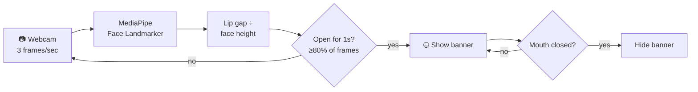

<div align="center">

# 🤐 Breathing

**A tiny macOS menu bar app that catches you mouth-breathing and nudges you to stop.**


[](LICENSE)

[Install](#-install) · [How it works](#-how-it-works) · [Usage](#-usage) · [Tuning](#%EF%B8%8F-tuning) · [FAQ](#-faq)

</div>

---

Breathing watches your webcam three times a second, measures how far apart your lips are, and when your
mouth has been hanging open for a second, a small banner slides into the corner of your screen:

> **🤐 Close your mouth**

Close it, and the banner disappears on its own. No clicking, no notification pile-up.

## ✨ Features

- **Hands-free reminders.** A banner appears when your mouth stays open and clears itself when you close it.
- **Ignores talking.** Normal speech opens and closes the mouth constantly, so it doesn't trigger a reminder.
- **Calibrated to your face.** A 5-second calibration learns your resting mouth position.
- **Works at any distance.** The lip gap is measured relative to face size, so leaning in or back doesn't matter.
- **Light on battery.** It analyses just 3 frames per second.
- **Lives in the menu bar.** Pause, resume, recalibrate or switch cameras from the 🤐 icon.
- **Private by design.** Every frame is processed locally and thrown away. Nothing is recorded, saved or uploaded.

## 🚀 Install

Paste this into **Terminal**:

```bash
curl -fsSL https://raw.githubusercontent.com/tomtan2007/breathing/main/install.sh | bash
```

That's it. It installs into `~/Applications/Breathing`, sets everything up and starts the app.
Allow camera access when macOS asks, then look for **🤐** in your menu bar.

To start it again later (after a restart, for example):

```bash
~/Applications/Breathing/run.sh
```

Run the install line again at any time to update. Your calibration is kept.

<details>
<summary><b>Manual install</b></summary>

```bash
git clone https://github.com/tomtan2007/breathing.git
cd breathing
./setup.sh   # creates a virtualenv and downloads the face model
./run.sh     # starts the menu bar app
```

</details>

**Requirements:** macOS with a webcam, and Python 3.9+ (if it's missing, the installer tells you to run
`xcode-select --install`).

## 🧠 How it works



1. **Detect.** Google's MediaPipe finds 478 points on your face in each frame.
2. **Measure.** It takes the distance between your inner upper and lower lip and divides it by face height.
3. **Compare.** A frame counts as *open* when that ratio is clearly above your calibrated resting value.
4. **Decide.** If at least 80% of the last second were open, you get a reminder. Talking flips between
   open and closed too often to reach that bar.
5. **Clear.** The moment your mouth closes, or you leave the desk, the banner hides.

## 🎛 Usage

Click **🤐** in the menu bar:

| Menu item | What it does |
|---|---|
| **Status line** | Live reading, e.g. `Mouth closed (gap 0.006, open above 0.021) · reminders: 3` |
| **Pause / Resume** | Fully releases the camera while paused, so the webcam light turns off |
| **Recalibrate** | Re-learns your closed-mouth baseline (keep your mouth closed for ~5 s) |
| **Show test reminder** | Previews the banner for 3 seconds |
| **Camera** | Picks which camera to use. Defaults to the built-in FaceTime camera. |
| **Quit** | Stops the app |

## ⚙️ Tuning

Adjust the constants at the top of [`breathing.py`](breathing.py), then re-run `run.sh`:

| Setting | Default | Meaning |
|---|---|---|
| `FPS` | `3` | Frames analysed per second |
| `WINDOW_SECONDS` | `1` | How long your mouth must look open before a reminder |
| `OPEN_FRACTION` | `0.8` | Share of frames in that window that must be open |
| `OPEN_MARGIN` | `0.015` | Lip gap above your resting baseline that counts as open. Lower = more sensitive. |
| `COOLDOWN_SECONDS` | `10` | Minimum time between reminders |
| `FACE_LOST_SECONDS` | `3` | How long your face can be out of view before the timer resets |
| `SOUND_NAME` | `"Purr"` | macOS system sound played with the banner (`""` for silent) |
| `SOUND_VOLUME` | `0.35` | Sound volume, 0.0–1.0 |

Calibration and your camera choice are saved in `~/.breathing.json`.

## ❓ FAQ

<details>
<summary><b>Can the webcam light be turned off?</b></summary>

No. On Macs the green light is wired to the camera's power in hardware, so no software can turn it
off while the camera is in use. That's a deliberate privacy feature. Use **Pause** when you don't
want the camera on.
</details>

<details>
<summary><b>Does it record or upload anything?</b></summary>

No. Each frame is analysed in memory and immediately discarded. The only file it writes is
`~/.breathing.json`, which holds one calibration number and your camera name.
</details>

<details>
<summary><b>Will running the camera all day damage it?</b></summary>

No. Webcams have no moving parts and are built for hours of daily video calls. The main cost is
a little battery, which is why it only checks 3 frames per second.
</details>

<details>
<summary><b>It's using the wrong camera.</b></summary>

Virtual cameras (Sony Imaging Edge, OBS, Continuity Camera, etc.) can show up first. Pick the
right one under **🤐 → Camera**. Your choice is remembered.
</details>

<details>
<summary><b>It doesn't detect my mouth being open.</b></summary>

Open the 🤐 menu and watch the status line. If the gap with your mouth slightly open stays below the
"open above" number, lower `OPEN_MARGIN` or choose **Recalibrate** with your mouth fully closed.
</details>

<details>
<summary><b>Does it work while I sleep?</b></summary>

No. It only works while you're in front of an awake Mac. When the lid is closed the camera is off.
</details>

## 🗑 Uninstall

```bash
pkill -f "[Pp]ython breathing.py"; rm -rf ~/Applications/Breathing ~/.breathing.json
```

## ⚠️ Limitations

- It detects **open lips**, not airflow, so mouth-breathing through barely parted lips may slip through.
- The webcam light stays on while monitoring (see the FAQ).
- You need to be facing the camera reasonably well for tracking to work.

---

<div align="center">
<sub>MIT licensed · Built with <a href="https://ai.google.dev/edge/mediapipe/solutions/vision/face_landmarker">MediaPipe</a>, <a href="https://opencv.org">OpenCV</a> and <a href="https://github.com/jaredks/rumps">rumps</a>.</sub>
</div>
